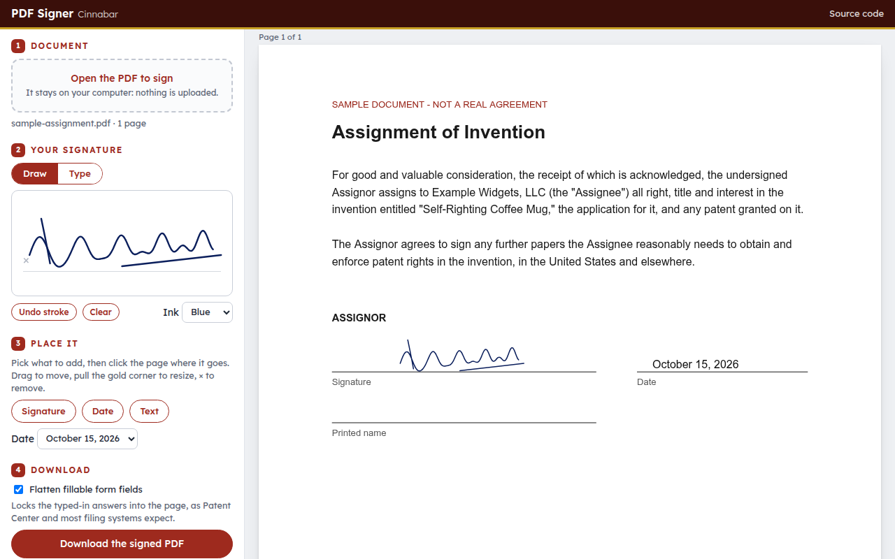

# PDF Signer (Oxblood): sign a PDF in your browser

Oxblood is a one-page PDF signer. You open a PDF, draw your signature with a mouse, trackpad or finger (or type it), click where it goes, add the date, and download the signed copy. The work happens in your browser: the document, your signature and the result are never uploaded.

**Try it:** open `index.html` from any web server (`python3 -m http.server`), or add `?demo` to the address to load a sample document.

## What it does
- **Drawn signatures** are written into the PDF as smooth vector strokes in blue or black ink. No image is embedded, so they stay sharp at any zoom and add only a few kilobytes.
- **Typed signatures** have an optional USPTO /S/ mode. It insists the signer types the slashes themselves (`/Jane Q. Inventor/`), as 37 CFR 1.4(d)(2) requires; it never adds them.
- **Date and free text** (a printed name, a title) can be placed anywhere, in four date formats.
- **Placement:** click to place, drag to move, pull the corner to resize (the proportions are kept), and press Delete or × to remove.
- **Fillable forms** are flattened on request, so the answers typed into a USPTO form are locked into the page before it is filed.
- **Coordinates:** rotated and offset pages are handled. Items are kept in page coordinates and converted with the pdf.js viewport.

It uses [pdf.js](https://mozilla.github.io/pdf.js/) to show the pages and [pdf-lib](https://pdf-lib.js.org/) to write the copy. Both load from cdnjs. There is no build step and no server code.

## What it is not
It gives no certificate-based digital signature, keeps no audit trail and checks no identity. It puts your mark on the page, nothing more. Whether a drawn or typed electronic signature is acceptable is up to the rules that govern the document.

## Name
Oxblood is the dark red of old sealing wax, the way documents were signed and sealed before ink signatures were enough.

MIT License.
